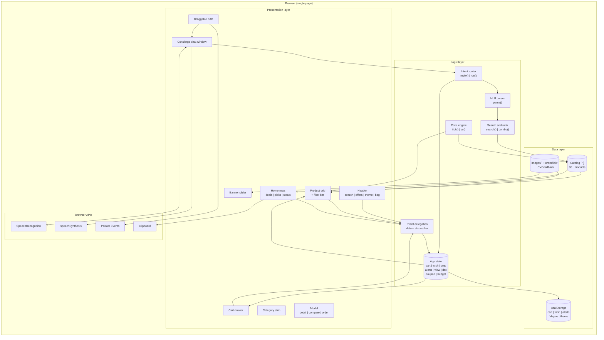
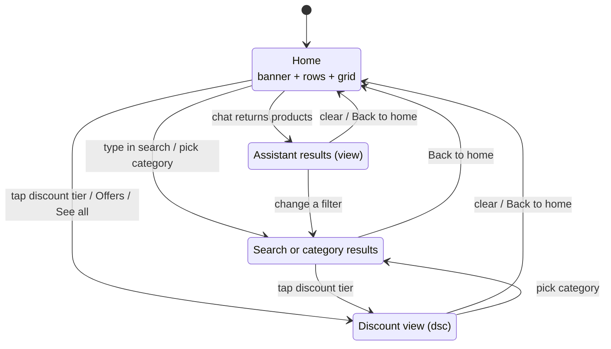
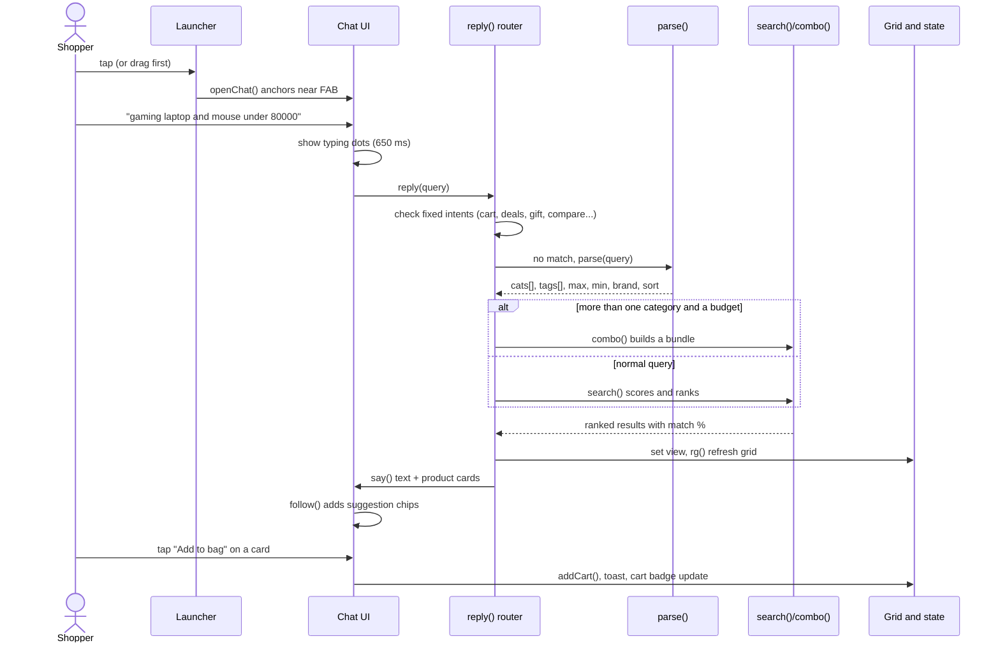
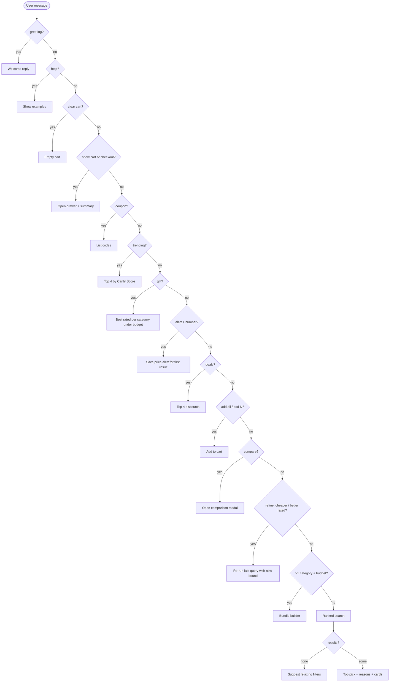
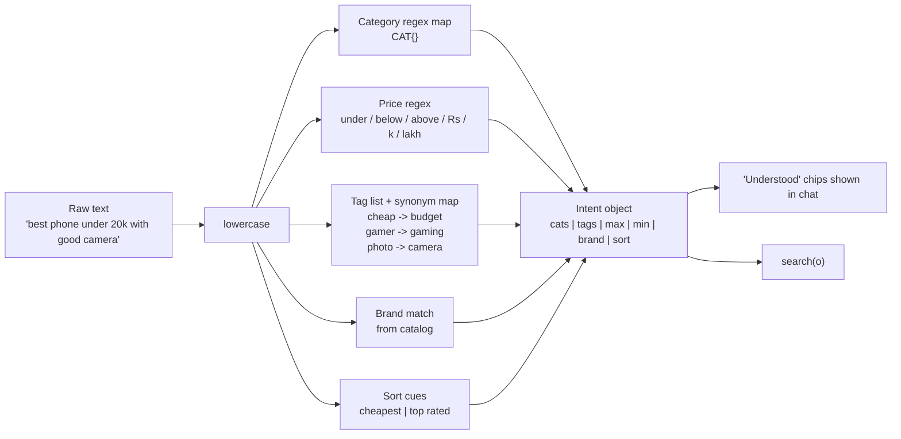
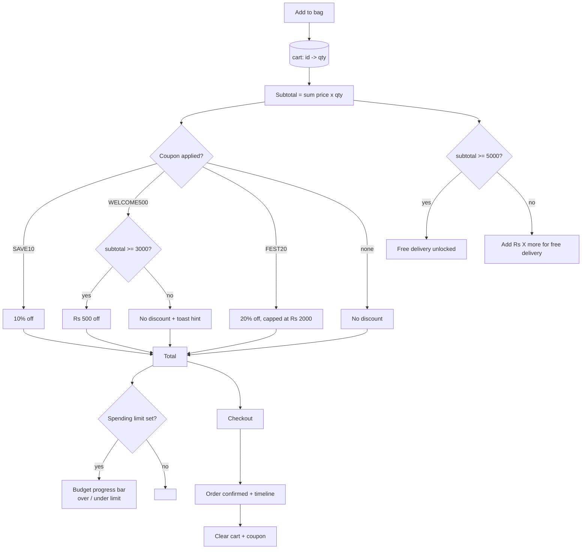
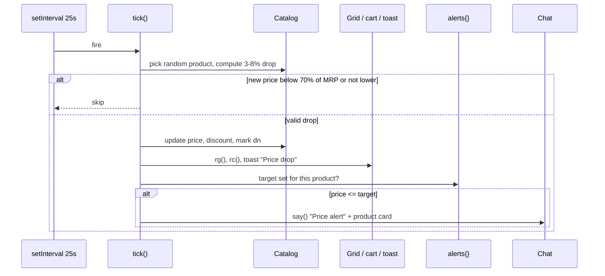
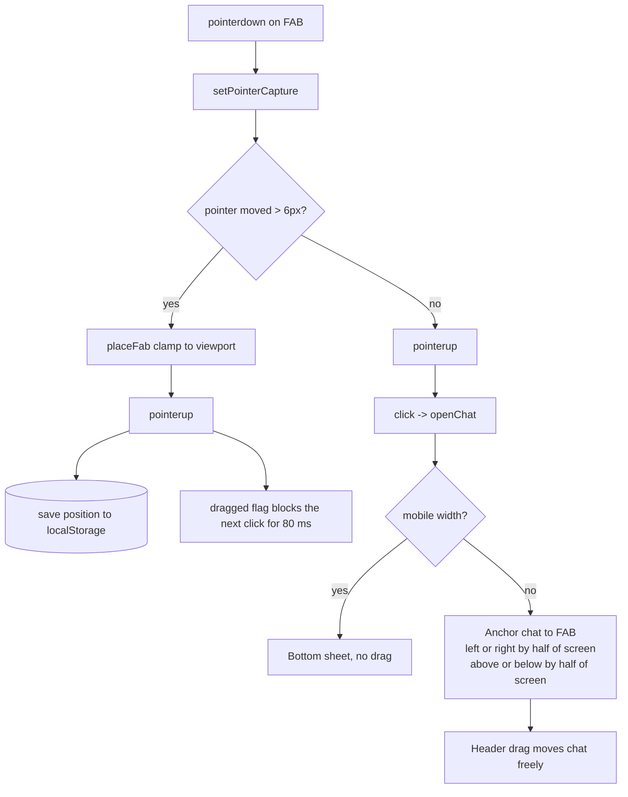
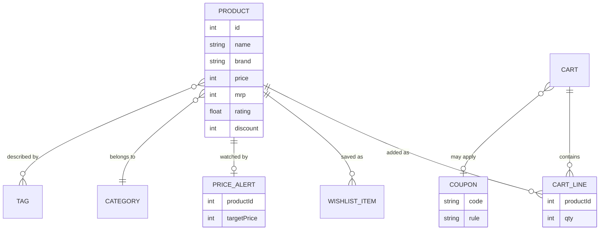
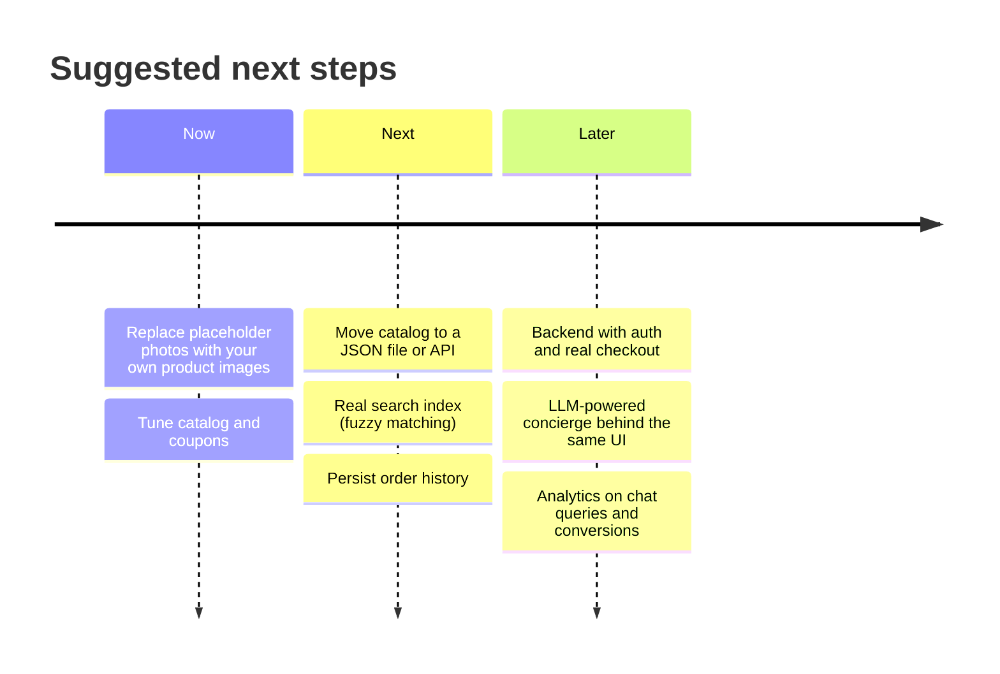

# Cartly: Intelligent Shopping Assistant

A single-file, zero-dependency e-commerce storefront with a built-in AI-style shopping concierge. Everything (catalog, search, cart, price alerts, comparison, chat assistant) runs in the browser from one `index.html`.

  

---

## Table of contents

1. [Highlights](#highlights)
2. [Quick start](#quick-start)
3. [Project structure](#project-structure)
4. [Architecture](#architecture)
5. [Cartly Concierge (chat assistant)](#cartly-concierge-chat-assistant)
6. [Draggable launcher](#draggable-launcher)
7. [Data model](#data-model)
8. [Scoring and pricing logic](#scoring-and-pricing-logic)
9. [Persistence](#persistence)
10. [Customization guide](#customization-guide)
11. [Keyboard shortcuts](#keyboard-shortcuts)
12. [Browser support](#browser-support)
13. [Known limitations](#known-limitations)
14. [Roadmap](#roadmap)

---

## Highlights

| Area | What you get |
|---|---|
| Storefront | Hero banner slider, category strip, discount tiers, coupon cards, horizontal product rows, filterable grid |
| Catalog | 90+ products across 13 categories with brand, rating, MRP, discount and tags |
| Search and filters | Header search, category, brand, rating, max price slider, 6 sort modes |
| Cartly Concierge | Natural-language chat: search, budget bundles, gift finder, deals, compare, price alerts, cart control |
| Voice | Speech-to-text input and read-aloud replies (where the browser supports it) |
| Product details | 12-week price trend sparkline, buy/wait advice, pros and cons, rating breakdown, delivery check, similar items |
| Cart | Quantity controls, 3 coupons, free-delivery progress bar, personal spending limit tracker, mock checkout |
| Live prices | Random price drops every 25 s with toasts and user-set alerts |
| Personalization | Wishlist, compare tray (up to 3), recently viewed, light/dark theme |
| UI | Draggable "Ask Cartly AI" launcher, movable chat window, cute mascot, responsive down to phones |

---

## Quick start

No build step, no server and no package install.

```bash
# Option 1: just open it
open index.html            # macOS
xdg-open index.html        # Linux
start index.html           # Windows

# Option 2: serve locally (recommended for sharing on your network)
python3 -m http.server 8080
# then visit http://localhost:8080
```

> Keep `index.html` and the `images/` folder together. If an image fails to load, the card falls back to a drawn SVG illustration automatically.

---

## Project structure

```
cartly/
├── index.html            # the whole app: markup, CSS, JS, catalog
├── README.md             # this file
└── images/
    ├── banner-appliances.jpg
    ├── banner-phones.jpg
    ├── banner-beauty.jpg
    ├── banner-gaming.jpg
    └── banner-cartly-ai.jpg
```

Inside `index.html` the code is laid out in this order:

```
<style>      design tokens -> base -> layout -> components -> overrides -> chat + launcher
<body>       header | category strip | chat window | banner | rows | shop grid | cart drawer | modal | FAB | toast
<script>
  1. Catalog (P) + derived fields (discount d, MRP o)
  2. State (cart, wish, cmp, alerts, view, dsc, coupon, budget)
  3. NLU: parse() -> search() / combo()
  4. Chat: ask() -> reply() -> run() -> say() -> follow()
  5. Rendering: rb() banners, rrows() home rows, rg() grid, det() detail, rc() cart, showCmp()
  6. Event delegation (single click listener keyed by data-a)
  7. Draggable launcher + movable chat
</script>
```

---

## Architecture

### 1. System block diagram



### 2. Page view state machine

The same grid serves four modes. `rx()` decides whether the home rows or the results view is shown.



### 3. Chat request lifecycle



### 4. Intent routing (order matters)



### 5. Natural-language parsing



### 6. Cart and pricing flow



### 7. Live price ticker and alerts



---

## Cartly Concierge (chat assistant)

The assistant is rule-based and runs fully offline. It does not call any external AI service.

### Things you can say

| Intent | Example |
|---|---|
| Search with budget | `best phone under 20k with good camera` |
| Budget bundle | `gaming laptop and mouse under 80000` |
| Gift ideas | `gift ideas under 3000` |
| Deals | `show deals` |
| Trending | `what is trending` |
| Compare | `compare` (uses last results or your compare picks) |
| Add to bag | `add 1`, `add first`, `add all` |
| Refine | `cheaper`, `better rated` |
| Price alert | `alert me below 20000` |
| Cart | `show cart`, `clear cart` |
| Coupons | `coupons` |
| Help | `help` |

### What the assistant shows

- **Understood chips**: the filters it extracted from your sentence.
- **Top pick with reasons**: for example "Rs 3,000 under your budget, matches camera, 4.6 star rating".
- **Product cards** with price, discount, Cartly Score, match percentage and quick actions.
- **Follow-up chips**: cheaper, better rated, compare, add to bag, set price alert.

### Voice

- Mic button: speech-to-text (`en-IN`) using the Web Speech API.
- Speaker button: read replies aloud.
- Both are feature-detected and degrade gracefully.

---

## Draggable launcher

The "Ask Cartly AI" button and the chat window are movable.



Behavior details:

- Free placement anywhere on screen; position is clamped so the button never leaves the viewport.
- Position survives reloads (`cartly_fab`).
- A tap and a drag are separated by a 6 px movement threshold, so dragging never accidentally opens the chat.
- When the chat is open the launcher fades out; closing the chat brings it back in place.
- On screens 700 px wide or less the chat becomes a bottom sheet.
- `Esc` closes the chat.

---

## Data model

### Catalog entry

Products are defined as compact arrays and expanded at load time.

```js
// [name, category, brand, price, rating, (unused), tags]
["iPhone 15", "Phones", "Apple", 69900, 4.7, "", "premium camera"]
```

Expanded object:

```js
{
  id: 0,                 // array index
  n: "iPhone 15",        // name
  c: "Phones",           // category
  b: "Apple",            // brand
  p: 69900,              // current price (changes with price drops)
  r: 4.7,                // rating
  t: "premium camera",   // space-separated tags
  d: 15,                 // discount % (derived from a price-band pattern)
  o: 82240,              // MRP derived from price and discount
  dn: 1                  // set to 1 after a live price drop
}
```

### Entity relationship overview



### Runtime state

| Variable | Type | Purpose |
|---|---|---|
| `cart` | `{id: qty}` | Items in the bag |
| `wish` | `number[]` | Saved product ids |
| `cmp` | `number[]` | Up to 3 products to compare |
| `alerts` | `{id: price}` | Price-drop targets |
| `view` | `{ids, pct?}` or `null` | Assistant result set shown in the grid |
| `dsc` | `{m, u, l}` or `null` | Active discount filter (min %, max price, label) |
| `coupon` | string or `null` | Applied coupon |
| `budget` | number | Personal spending limit |
| `last`, `lastO` | arrays, object | Last results and last parsed query, used for follow-ups |

---

## Scoring and pricing logic

### Cartly Score (0-99)

Shown on cards and used by "Trending" and the "Cartly Score" sort.

```
score = min(99, round(
    rating/5 * 62
  + discount% * 1.1
  + (1 - price / maxPriceInCategory) * 14
))
```

It rewards high ratings first, then bigger discounts, then value within the category.

### Match percentage (assistant)

```
raw   = rating * 10
      + 12 per matched tag
      + (price / budget) * 6          // only when a budget is given
max   = 50 + 12 * tagCount + 6
match = min(99, round(raw / max * 100))
```

### Bundle builder

For queries that name more than one category and a budget, `combo()`:

1. Walks the categories in order.
2. Reserves the cheapest item for every category still to come.
3. Picks the highest-rated product that fits the remaining money.
4. Falls back to the cheapest option when nothing fits, and says so.

### Smart compare

Value score is `rating / price * 10000`. The modal highlights the lowest price, best rating and best value, and writes a one-line verdict.

---

## Persistence

| Key | Contents |
|---|---|
| `cartly_cart` | Cart contents |
| `cartly_wish` | Wishlist |
| `cartly_al` | Price alerts |
| `cartly_fab` | Launcher position `{x, y}` |
| `cartly_theme` | `light` or `dark` |

All access is wrapped in `try/catch`, so the site still works in private windows where storage is blocked.

---

## Customization guide

### Replace product photos

Near the top of the image section:

```js
const IMG = {};
// IMG[productId] = 'images/iphone15.jpg';
IMG[0] = 'images/iphone15.jpg';
```

Lookup order: `IMG[id]` -> loremflickr keyword photo -> drawn SVG fallback.

Tips: use square or 4:3 images around 800x600 px, plain light background, under 300 KB each.

### Replace banners

```js
const BIMG = {
  0: 'images/banner-appliances.jpg',
  1: 'images/banner-phones.jpg',
  2: 'images/banner-beauty.jpg',
  3: 'images/banner-gaming.jpg',
  4: 'images/banner-cartly-ai.jpg'
};
```

Use wide images around 1600x700 px with the subject on the right. The left side carries the headline text and gets a dark gradient overlay.

### Edit banner text

Each entry in the `BN` array is:

```js
[title, subtitle, buttonLabel, category, svgKey, hue, gradient, imageKeyword, badge]
```

An empty category makes the button open the chat instead of a category.

### Add or edit products

Append to the array `P`:

```js
["Product name", "Category", "Brand", 1999, 4.3, "", "budget wireless battery"]
```

- Use an existing category name so it appears in the strip and filters.
- Tags drive assistant matching. Known tags: gaming, battery, camera, budget, premium, wireless, fitness, student, noise, fast, inverter, energy, 4k, oled, luxury, organic, insulated, steel, glass, multiplayer, family, makeup, skincare, fragrance, haircare.
- To add a new category, also add it to the `CAT` regex map (so the chat understands it), the `CK` icon map, and `artKey()`.

### Coupons

Defined in three places: the `CPN` array (cards), the discount logic in `rc()`, and the list inside the `#ap` click handler.

| Code | Rule |
|---|---|
| `SAVE10` | 10% off |
| `WELCOME500` | Rs 500 off at Rs 3,000 or more |
| `FEST20` | 20% off, up to Rs 2,000 |

### Theme and brand colors

All colors are CSS variables on `:root`; the last `:root` block in the stylesheet wins.

```css
--bg --c --t --m --a --b --g --on
```

`--a` is the maroon accent. Dark values live under `@media (prefers-color-scheme: dark)` and `:root[data-theme=dark]`.

### Chat window size

```css
#chat { width: min(440px, calc(100vw - 24px)); height: min(700px, calc(100vh - 110px)); }
```

### Price-drop frequency

```js
setInterval(tick, 25000);   // milliseconds
```

---

## Keyboard shortcuts

| Key | Action |
|---|---|
| `/` | Focus the chat input |
| `Esc` | Close modal, cart drawer, then chat |
| `Enter` | Send chat message / run header search |

---

## Browser support

| Browser | Support |
|---|---|
| Chrome, Edge (current) | Full, including voice input |
| Safari 16.4+ | Full (watch-category regex needs lookbehind support) |
| Firefox (current) | Full except speech recognition |
| Mobile Chrome / Safari | Full, chat becomes a bottom sheet |

Features used: CSS `color-mix()`, `:has()`, CSS grid, Pointer Events, `localStorage`, optional Web Speech API.

---

## Known limitations

- **Prototype data**: prices, ratings and reviews are generated or hard-coded. There is no backend, real checkout or payment.
- **Discounts and MRP** are derived from a deterministic pattern, not stored data.
- **Chat is rule-based**: it understands the supported phrasing, not free-form conversation.
- **Placeholder photos** come from a keyword photo service and may not match the product; replace them via `IMG`.
- **Price ticker** changes in-memory prices only; they reset on reload.
- **Voice input** needs HTTPS (or localhost) and a supporting browser.

---

## Roadmap



---

## Credits

Built with plain HTML, CSS and JavaScript. Fonts: Fraunces and Inter (Google Fonts). Placeholder photos: loremflickr.
